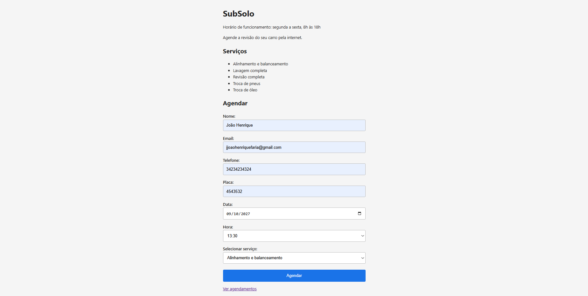
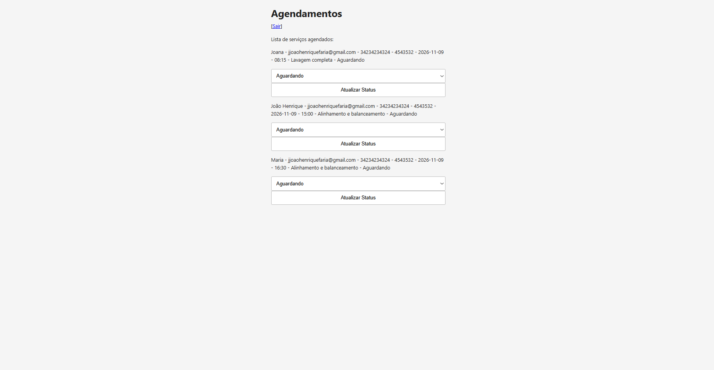

# Agendamento SubSolo

Sistema web de agendamento para oficina mecânica. O cliente escolhe o horário pelo celular, sem telefonar; o funcionário acompanha a agenda e atualiza o status de cada serviço.

**Site no ar:** https://agendamento-subsolo.onrender.com

> O projeto está hospedado no plano gratuito do Render, que coloca o serviço para dormir depois de um tempo sem acesso. A primeira visita pode levar cerca de 30 segundos para carregar.

---

## Telas

| Agendamento (cliente) | Painel (funcionário) |
| --- | --- |
|  |  |

---

## Funcionalidades

- Formulário público de agendamento com nome, e-mail, telefone, placa, data, horário e serviço
- Horários gerados automaticamente em intervalos de 45 minutos, das 08:15 às 17:20
- Agendamento recusado quando a data já passou, cai em fim de semana ou no horário de almoço (12:00 às 13:00)
- Horário já ocupado não pode ser marcado por outro cliente
- Serviço precisa existir no cadastro do banco
- Em caso de erro, a mensagem aparece na própria página e os dados digitados são preservados
- Área do funcionário protegida por login, com senha armazenada em hash
- Painel com a lista de agendamentos ordenada por data e hora
- Atualização do status de cada serviço: Aguardando, Em andamento, Pronto
- Status validado no servidor, não apenas no formulário
- Layout responsivo, pensado para o celular

---

## Tecnologias

- **Python 3** e **Flask** — rotas, sessão e renderização
- **Jinja2** — templates com herança a partir de um `base.html`
- **SQLite** — banco de dados, acessado via `sqlite3` com consultas parametrizadas
- **Werkzeug** — hash de senha (`generate_password_hash` / `check_password_hash`)
- **pytest** — testes automatizados
- **python-dotenv** — variáveis de ambiente em desenvolvimento
- **Gunicorn** e **Render** — servidor de produção e hospedagem

---

## Estrutura do projeto

```
main.py          cria e configura a aplicação Flask
routes.py        as rotas do site
validacoes.py    regras de negócio (horários, datas, status) — não conhece web nem banco
database.py      criação das tabelas e cadastro inicial de serviços
admin.py         criação do usuário administrador a partir das variáveis de ambiente
conftest.py      fixture do pytest que cria e remove o usuário de teste
test_client.py   testes automatizados
templates/       páginas HTML
static/          folha de estilo
```

---

## Como rodar localmente

```bash
git clone https://github.com/joaohfaria/agendamento-dev.git
cd agendamento-dev
```

Crie e ative o ambiente virtual:

```bash
python -m venv venv
venv\Scripts\activate        # Windows
source venv/bin/activate     # Linux / macOS
```

Instale as dependências:

```bash
pip install -r requirements.txt
```

Crie um arquivo `.env` na raiz com as variáveis abaixo (os valores são seus; este arquivo não vai para o repositório):

```
SECRET_KEY=uma-chave-longa-e-aleatoria
ADMIN_USUARIO=nome-do-usuario-administrador
ADMIN_SENHA=senha-do-administrador
FLASK_DEBUG=1
```

A aplicação não sobe sem `SECRET_KEY` — ela falha na inicialização com uma mensagem explícita, de propósito, para não rodar com sessão insegura.

Rode:

```bash
python main.py
```

O site fica em `http://127.0.0.1:5000`. As tabelas e o usuário administrador são criados automaticamente na primeira execução.

---

## Testes

```bash
pytest
```

São 5 testes automatizados, que verificam:

- a página inicial responde e traz os campos do formulário
- a lista de agendamentos redireciona quem não está logado
- a lista de agendamentos abre para quem está logado
- o login funciona com credenciais válidas
- um status fora da lista permitida é recusado com HTTP 400

O usuário usado nos testes é criado e apagado por uma fixture do pytest, então nenhuma senha real aparece no código.

---

## Segurança

- Senhas gravadas apenas como hash, nunca em texto
- Todas as consultas SQL usam parâmetros (`?`), nunca concatenação de texto
- Segredos em variáveis de ambiente, com valores diferentes em desenvolvimento e produção
- `.env` e o arquivo do banco fora do controle de versão
- Rotas da área do funcionário verificam a sessão antes de qualquer operação
- Dados vindos do formulário são validados no servidor, independentemente do que o HTML oferece

---

## Limitações conhecidas

- **O banco é apagado nos reinícios.** O SQLite grava num arquivo em disco, e o disco do plano gratuito do Render é efêmero: a cada deploy ou reinício do serviço os agendamentos são perdidos. A correção é migrar para PostgreSQL, e é a próxima tarefa do projeto.
- **Não existe tela para trocar a senha.** A senha do administrador só muda pela variável de ambiente.
- **Não há confirmação por e-mail nem lembrete automático** para o cliente.
- **Os horários ocupados continuam aparecendo na lista** do formulário; o cliente só descobre que o horário está tomado depois de enviar.

---

## Próximos passos

- Migrar o banco para PostgreSQL
- Esconder da tela os horários já ocupados, usando JavaScript
- Tela de troca de senha
- Lembrete automático por e-mail para o cliente

---

Projeto desenvolvido por [João Henrique Faria](https://github.com/joaohfaria) como estudo prático de desenvolvimento web com Python.
